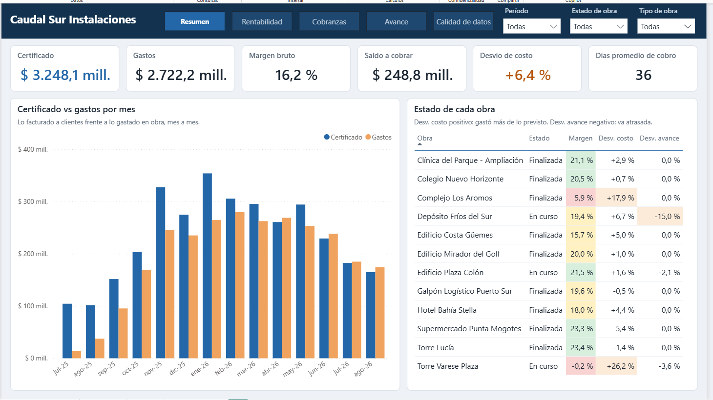
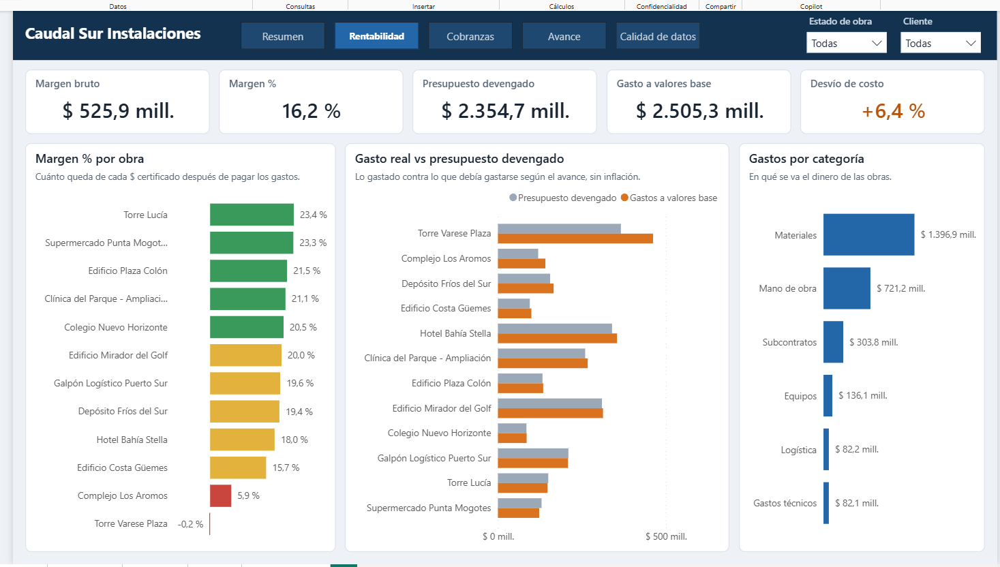
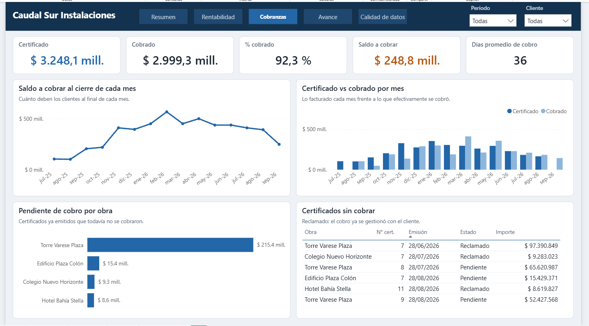
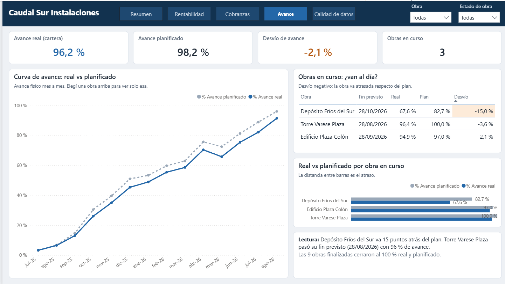
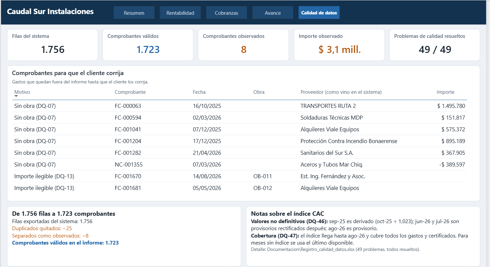

# Control de obras de una empresa de instalaciones

Este proyecto es un informe de Power BI para Caudal Sur Instalaciones, una empresa que hace instalaciones en obras de construcción. Cubre 12 obras entre julio de 2025 y agosto de 2026 (los cobros llegan hasta septiembre de 2026). La idea fue armar un tablero de control para el dueño o el gerente de la empresa: cuánto se certificó y cuánto se gastó en cada obra, qué obras dejan plata y cuáles no, cuánto deben los clientes y si las obras en curso van al día con el plan.

> **Nota:** los datos son ficticios. El dataset fue generado para practicar, simulando la exportación del sistema de gestión de una empresa real, con errores de carga incluidos.

## Qué pregunta busca responder

- ¿Cuánto se certificó, cuánto se gastó y qué margen queda?
- ¿Qué obras son rentables y en cuáles se gastó más de lo presupuestado?
- ¿El sobrecosto es real o es solo inflación?
- ¿Cuánto deben los clientes, quién debe más y cuánto se tarda en cobrar?
- ¿Las obras en curso van al día o están atrasadas?
- ¿Qué tan confiables son los datos que vienen del sistema?

## Estructura del informe

El archivo tiene cinco páginas con un encabezado común para navegar entre ellas. Cada página tiene sus propios filtros (período, estado de obra, tipo de obra, cliente u obra, según lo que tenga sentido en cada una).

1. **Resumen**: certificado, gastos, margen bruto, saldo a cobrar, desvío de costo y días promedio de cobro; certificado contra gastos mes a mes y una tabla con el estado de cada obra (margen, desvío de costo y desvío de avance, con colores).
2. **Rentabilidad**: margen % por obra, gasto real contra presupuesto devengado (sin inflación) y gastos por categoría.
3. **Cobranzas**: certificado, cobrado y % cobrado; saldo a cobrar al cierre de cada mes, certificado contra cobrado por mes, pendiente de cobro por obra y el detalle de los certificados sin cobrar.
4. **Avance**: avance real contra planificado de toda la cartera, curva de avance mes a mes y el estado de las obras en curso.
5. **Calidad de datos**: cuántas filas vinieron del sistema, cuántas quedaron válidas, qué comprobantes tiene que corregir el cliente y notas sobre el índice de costos usado.

### Resumen

### Rentabilidad

### Cobranzas

### Avance

### Calidad de datos

## Cómo está armado

### Limpieza de datos

Los gastos vienen de una exportación del sistema con 1.756 filas. Antes de usarlas:

- Quité **25 filas duplicadas**.
- Separé **8 comprobantes observados** en una tabla aparte: 6 sin obra asignada y 2 con el importe ilegible. Suman $3,1 millones y quedan fuera del informe hasta que el cliente los corrija.
- Quedaron **1.723 comprobantes válidos**.

En total registré 49 problemas de calidad, todos resueltos, en un registro aparte (`Documentacion\Registro_calidad_datos.xlsx`).

### Modelo de datos

- **Hechos**: `gastos_sistema` (comprobantes de gasto), `Certificaciones` (lo que se le factura al cliente por avance de obra) y `Avance` (avance real y planificado por obra y mes).
- **Dimensiones**: `Obras` (nombre, tipo, cliente, estado y fin previsto), `Calendario`, `rubros` (categoría del gasto) y `proveedores`.
- **Auxiliares**: `indice_cac` (índice del costo de la construcción, para pasar los gastos a valores base) y `Gastos_Observados` (los comprobantes separados en la limpieza).
- **Medidas**: todas en una tabla `Medidas`.

### Medidas

- **Resultado**: certificado, gastos, margen bruto y margen %.
- **Costos**: presupuesto devengado (lo que debía gastarse según el avance), gastos a valores base y desvío de costo %.
- **Cobranzas**: cobrado, % cobrado, saldo a cobrar, pendiente de cobro y días promedio de cobro.
- **Avance**: % avance real, % avance planificado, desvío de avance y obras en curso.
- **Calidad**: filas del sistema, comprobantes, comprobantes observados, gastos observados y problemas de calidad resueltos.

Una decisión importante: para medir el sobrecosto, comparo el presupuesto con los gastos **a valores base**, ajustados con el índice CAC. Si comparo con los gastos en pesos corrientes, la inflación hace que todas las obras parezcan pasadas de presupuesto, aunque se hayan comprado las mismas cosas.

## Lo que muestran los datos

- **La empresa gana, pero con margen justo.** Se certificaron **$3.248,1 millones** y se gastaron **$2.722,2 millones**: un margen bruto de **$525,9 millones (16,2%)**.
- **Se gastó un 6,4% más de lo previsto**, ya descontada la inflación: $2.505,3 millones a valores base contra $2.354,7 millones de presupuesto devengado.
- **Dos obras explican casi todo el problema.** Torre Varese Plaza tiene un sobrecosto del **26,2%** y un margen de **-0,2%** (pierde plata). Complejo Los Aromos se pasó un **17,9%** y le quedó un margen de solo **5,9%**. Las otras diez obras tienen márgenes de entre 15,7% y 23,4%.
- **Los materiales son más de la mitad del gasto:** $1.396,9 millones, seguidos por mano de obra ($721,2 millones) y subcontratos ($303,8 millones).
- **Se cobró el 92,3% de lo certificado.** Quedan **$248,8 millones** a cobrar y se tarda en promedio **36 días** en cobrar. Torre Varese Plaza debe **$215,4 millones**, casi todo el saldo, en tres certificados sin cobrar.
- **Una obra en curso está muy atrasada.** Depósito Fríos del Sur va **15 puntos atrás del plan** (67,6% real contra 82,7% planificado). Torre Varese Plaza pasó su fecha de fin (28/08/2026) con el 96,4% de avance. Las 9 obras finalizadas cerraron al 100%.

**Recomendación principal:** poner el foco en Torre Varese Plaza. Es la obra con más sobrecosto, la que pierde plata, la que más debe y está atrasada. Conviene revisar qué pasó con el costo, reclamar los certificados pendientes y negociar con el cliente un ajuste por los cambios o mayores costos. En segundo lugar, armar un plan para recuperar el atraso de Depósito Fríos del Sur antes de que también se le dispare el costo.

## Limitaciones

- Los datos son ficticios.
- Algunos valores del índice CAC no son definitivos: septiembre de 2025 se calculó a partir de octubre, junio y julio de 2026 son provisorios rectificados y agosto de 2026 es provisorio. Para los meses sin índice se usa el último disponible.
- Los 8 comprobantes observados quedan fuera de los gastos hasta que se corrijan, así que el gasto real puede ser algo mayor.

## Herramientas

- Power BI Desktop
- Power Query para la limpieza y el modelado
- DAX para las medidas

## Cómo verlo

Descargá el archivo `Caudal_Sur_Control_de_Obras.pbix` y abrilo con Power BI Desktop (es gratuito). El informe se ve con los datos ya cargados.
