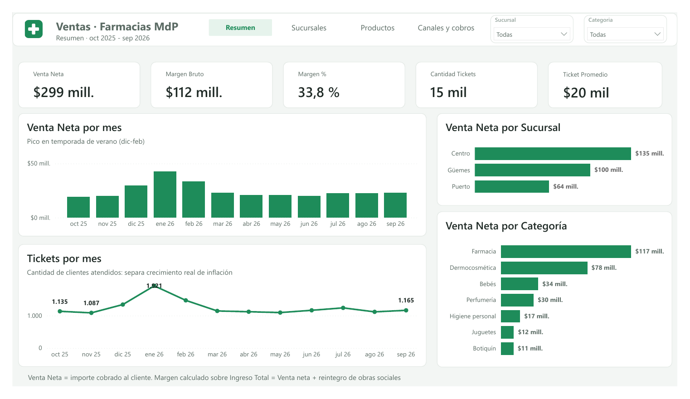
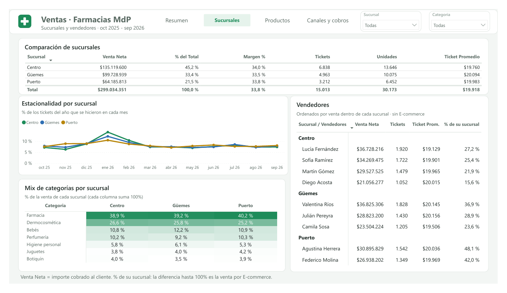
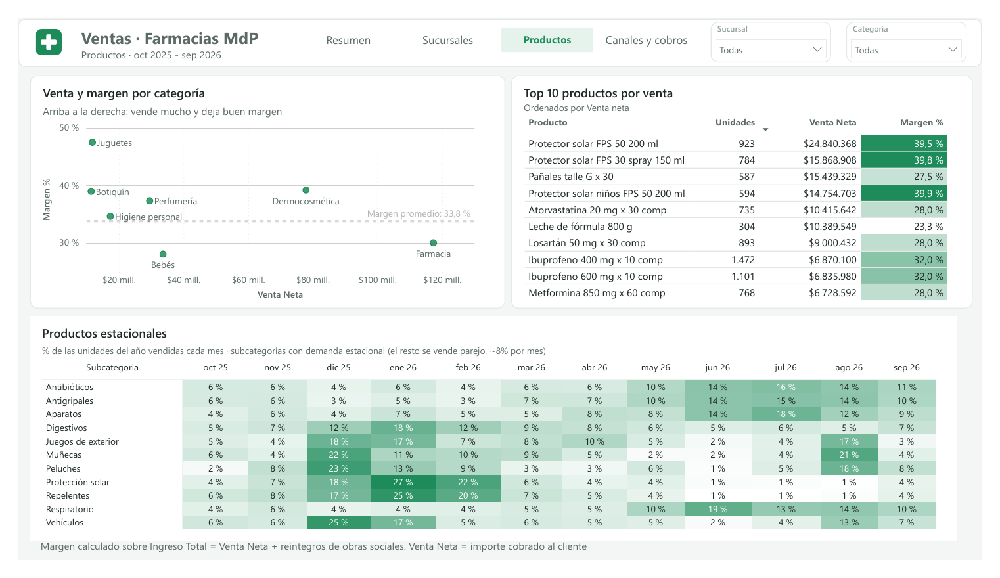
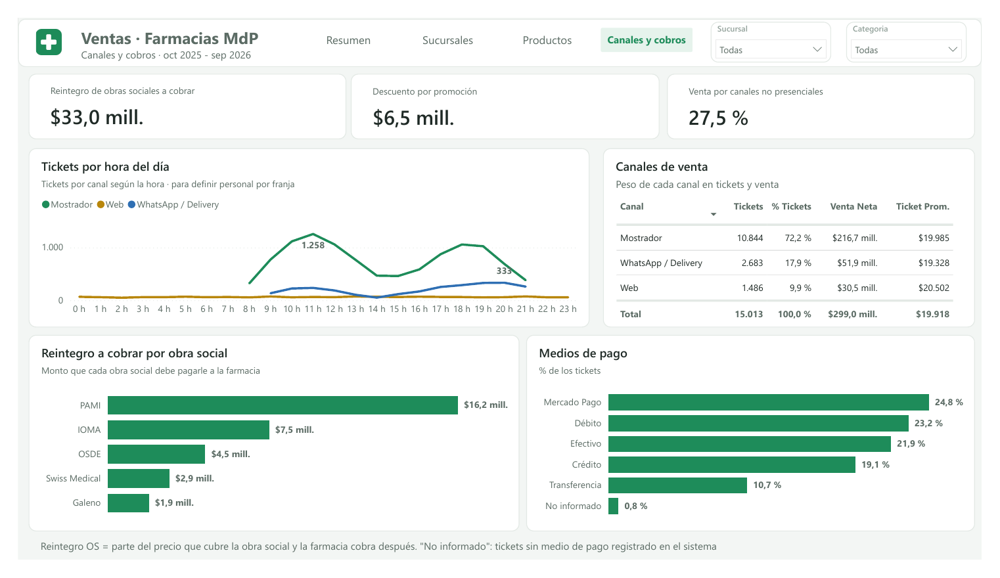

# Ventas de una cadena de farmacias en Mar del Plata

Este proyecto es un informe de Power BI sobre las ventas de una cadena de tres farmacias de Mar del Plata (Centro, Güemes y Puerto) entre octubre de 2025 y septiembre de 2026. Son 24.200 líneas de venta y 15.013 tickets. La idea fue armar algo que pueda usar el dueño de la cadena para ver cómo viene el negocio, qué sucursal y qué productos rinden más, cómo pega la temporada de verano y cuánta plata le deben las obras sociales.

> **Nota:** los datos son ficticios. El dataset fue generado para practicar, con precios aproximados y comportamientos parecidos a los reales (temporada turística, enfermedades de invierno, obras sociales, inflación mensual). Las marcas son reales para que el ejemplo se vea natural, pero las cifras no corresponden a ninguna farmacia existente.

## Qué pregunta busca responder

- ¿El negocio crece de verdad o el aumento de la venta es solo inflación?
- ¿Qué sucursal rinde más y cuánto depende cada una de la temporada de verano?
- ¿Qué categorías y productos venden más y cuáles dejan mejor margen?
- ¿Qué productos son de temporada, para comprar stock antes de que llegue el pico?
- ¿Cuánto pesan WhatsApp y la web frente al mostrador, y en qué horarios se vende por cada canal?
- ¿Cuánto les deben las obras sociales a las farmacias y quién concentra esa deuda?

## Estructura del informe

El archivo tiene cuatro páginas con un encabezado común: navegación entre páginas y filtros por sucursal y categoría, sincronizados en todo el informe.

1. **Resumen**: venta neta, margen bruto, margen %, tickets y ticket promedio, la evolución mensual de la venta y de los tickets, y la venta por sucursal y por categoría.
2. **Sucursales**: comparación de las tres sucursales, estacionalidad de cada una, mix de categorías y ranking de vendedores dentro de cada sucursal.
3. **Productos**: venta y margen por categoría, top 10 de productos y un mapa de calor con las subcategorías de demanda estacional.
4. **Canales y cobros**: reintegro de obras sociales a cobrar, descuentos por promoción, peso de los canales no presenciales, tickets por hora del día, canales de venta, reintegro por obra social y medios de pago.

### Resumen

### Sucursales

### Productos

### Canales y cobros

## Cómo está armado

### Limpieza en Power Query

El CSV venía con errores de carga, como pasa con cualquier exportación de un sistema. Los encontré con el perfil de columnas (sobre todo el conjunto de datos, no solo las primeras 1.000 filas) y los corregí así:

- **Medios de pago vacíos** (120 líneas): los reemplacé por "No informado" en lugar de borrar las filas, para no perder ventas reales.
- **Espacios sobrantes** en los nombres de vendedores: recortar.
- **Sucursales escritas de distintas formas** (mayúsculas, minúsculas, espacios): mayúscula en cada palabra y recortar.
- **Descuentos con formatos mezclados** (0.15 y 15%): conversión a decimal con configuración regional en inglés y control de que todos los valores quedaran entre 0 y 0,50.
- **Fechas en formato argentino** (dd/mm/aaaa): conversión con configuración regional en español.
- **38 filas duplicadas**: las inspeccioné antes de quitarlas y validé que el identificador de línea quedara único (24.200 filas).

La consulta limpia no se carga al modelo: funciona como paso intermedio y de ella salen, por referencia, la tabla de hechos y las dimensiones.

### Modelo de datos

Modelo en estrella:

- **Fact_Ventas**: una fila por producto dentro de un ticket, con cantidad, precio, costo, descuento, canal, medio de pago, obra social y hora.
- **Dim_Producto**: producto, categoría, subcategoría, marca, si requiere receta y una columna que clasifica cada subcategoría como de demanda anual o estacional.
- **Dim_Sucursal** y **Dim_Vendedor**: con identificadores generados en Power Query.
- **Dim_Calendario**: creada con DAX y marcada como tabla de fechas, con mes, trimestre, día de la semana y temporada.

Las medidas están en una tabla aparte, organizadas en carpetas:

- **Ventas**: venta bruta, venta neta, reintegro de obras sociales, ingreso total, costo, descuentos por promoción y participaciones (`CALCULATE` con `REMOVEFILTERS` y `KEEPFILTERS`).
- **Márgenes**: margen bruto y margen %.
- **Tickets**: cantidad de tickets (`DISTINCTCOUNT`), unidades, ticket promedio y unidades por ticket.
- **Tiempo**: venta y tickets del mes anterior y su variación (`PREVIOUSMONTH`), porcentaje del año por mes y medidas para etiquetar solo los puntos clave de los gráficos (primero, último, máximo y mínimo), con variables y `ALLSELECTED`.

Una decisión importante: cuando un afiliado compra con obra social, paga una parte y la obra social le paga el resto a la farmacia después. Por eso el margen se calcula sobre el **ingreso total** (lo que paga el cliente más el reintegro de la obra social). Si se calcula solo con lo que se cobra en el mostrador, los medicamentos con receta aparecen con margen negativo, lo cual no es real.

## Lo que muestran los datos

- **El crecimiento en pesos es casi todo inflación.** Entre octubre de 2025 y septiembre de 2026, la venta neta mensual subió un 19,5%, pero los tickets crecieron solo un 2,6%. El negocio está estable en cantidad de clientes; lo que sube es el precio.
- **El verano manda, sobre todo en Centro.** Enero es el mes pico (1.921 tickets contra unos 1.100 en un mes normal). En Centro, enero concentra el 14,2% de los tickets del año; en Puerto, el 10,6%. Centro depende mucho más del turismo y Puerto tiene una clientela estable todo el año.
- **Centro vende más porque atiende más clientes, no porque cada uno gaste más.** Concentra el 45,2% de la venta, pero el ticket promedio es casi igual en las tres sucursales (entre $19.760 y $20.094).
- **Farmacia vende más; Dermocosmética y Juguetes dejan más margen.** Farmacia factura $117 millones con un margen del 30%. Dermocosmética tiene un margen del 39,2% y Juguetes del 47,5%, aunque vende poco.
- **Los protectores solares son los productos estrella.** Los tres primeros del top 10 son protectores solares, con márgenes cercanos al 40%. La leche de fórmula vende bien, pero tiene el margen más bajo del top (23,3%).
- **Once subcategorías son de temporada.** Protección solar vende el 27% de sus unidades del año solo en enero; antigripales, antibióticos e inhaladores tienen su pico entre junio y agosto; y los juguetes tienen dos picos: diciembre y agosto (Navidad y Día del Niño).
- **Uno de cada cuatro pesos entra por canales no presenciales.** WhatsApp / Delivery y Web suman el 27,5% de la venta. El mostrador tiene dos picos (11 h y entre las 18 y las 19 h), WhatsApp se concentra a la noche (pico a las 20 h) y la web vende pareja las 24 horas.
- **Las obras sociales deben $33 millones, y PAMI la mitad.** PAMI concentra el 49% del reintegro a cobrar ($16,2 millones). Las promociones, en cambio, le costaron a la cadena $6,5 millones.

**Recomendación principal:** reforzar personal y stock en Centro entre diciembre y febrero, comprar con anticipación los productos de temporada, y seguir de cerca la cobranza de PAMI, que es la principal deuda de la cadena.

## Limitaciones

- Los datos son ficticios y cubren solo 12 meses, así que no hay comparación con el año anterior.
- El reintegro de las obras sociales se toma como cobrado en su totalidad. En la realidad hay demoras y débitos que el dataset no tiene.
- El mix de categorías es casi igual en las tres sucursales porque el dataset se generó con la misma distribución de productos.
- Los identificadores de sucursal y vendedor se generaron con una columna de índice en Power Query. En una empresa real vendrían del sistema (por ejemplo, el legajo).

## Herramientas

- Power BI Desktop
- Power Query para limpieza y modelado
- DAX para las medidas y la tabla calendario

## Cómo verlo

Descargá el archivo `Ventas_Farmacias_MdP.pbix` y abrilo con Power BI Desktop (es gratuito). El informe se ve con los datos ya cargados. Si querés actualizarlo, descargá también `ventas_farmacia_mdp.csv` y cambiá la ruta del origen en Power Query.
